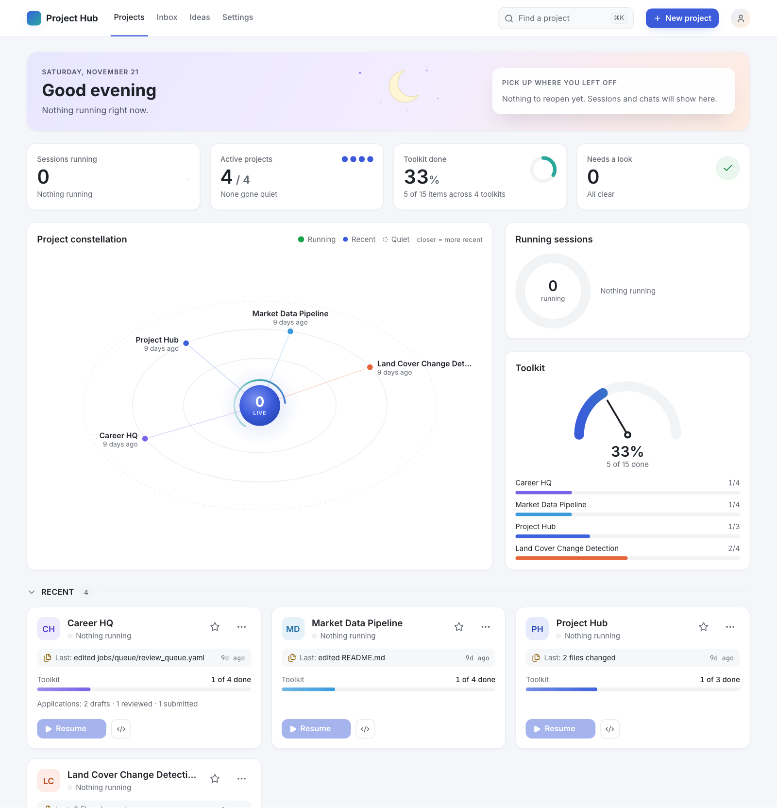
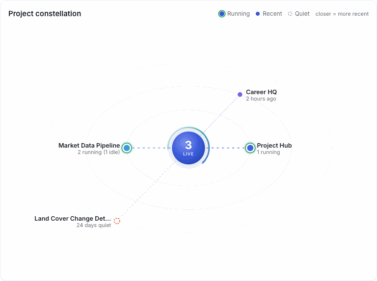

# Project Hub

[](https://github.com/mtelliott13-rgb/project-hub/actions/workflows/ci.yml)

A local dashboard for everything I'm building with Claude: one card per project
showing its recent Claude Code sessions, claude.ai chats, git and CI status,
recently changed files, links, notes and ideas, with one click to pick up where
I left off.





I use it every day on my own projects. The screenshot and `sample-data/` use made-up content so my job applications, chats and notes stay private.

**TypeScript · Hono · SQLite/Drizzle · React · Vite · Tailwind · Vitest**: 282 tests, CI on every push.

It runs on your own Mac, listens only on `127.0.0.1`, and keeps its data in
`~/.project-hub/`. Project data stays on this Mac. What goes out:

- **GitHub:** read-only `gh` requests (open PRs and the latest Actions run) for
  repos with a GitHub remote, every few minutes. The hub never fetches, pushes
  or writes anything there.
- **Claude, only when I click:** Monetize's Generate runs Claude Code, which
  sends the project files it reads to Claude and may search the web. Resume and
  the launch buttons open Claude Code or the Claude app, which then work as
  usual.
- **Google Calendar, only after I connect it** (Settings → Connections; off by
  default). Connecting opens Google's sign-in page, and Google sends the hub a
  code it trades for tokens at `oauth2.googleapis.com`. Then:
  - Every 10 minutes, at start and on "Sync now", it reads events on my primary
    calendar from today through 14 days out.
  - When I confirm a reminder, it creates that one event.
  - Undo deletes that one event.
  - If Google rejects the sign-in, it stops and waits for Reconnect.
  - It keeps only each event's title, times, link and linked project, never
    descriptions, locations or guests.
- **Quick-add's parser, only when I press Enter in the quick-add bar** (or
  click a note's "Add to calendar?"). It sends the text I typed, today's date
  and time, my time zone and my project names and slugs, and nothing else.
  Where it goes depends on the parser chosen in Settings:
  - **Claude Code** (the default) sends it to Claude through `claude -p`, on my
    Claude plan.
  - **Anthropic API** sends it to `api.anthropic.com` with my own API key.
    Connecting that key sends it once to check it.
  - **None** sends nothing.

> **macOS only.** It opens sessions in Terminal.app and files in VS Code, starts
> at login through launchd, and learns about Claude Code sessions through Claude
> Code hooks. It isn't built or tested for Linux or Windows (CI runs the tests
> on Linux, but the app itself assumes a Mac).

## What it does

- **Projects** defined in `~/.project-hub/projects.yaml` (folders, repos, GitHub
  names, keywords). You can edit them from the page, and the page keeps your
  comments and layout. Hand edits show up live.
- **Claude Code sessions** filed to projects by folder, with running/ended
  state. **Resume** reopens the newest one in Terminal.app.
- **claude.ai chats** filed by Claude Project or title keywords, through a small
  Chrome extension (`extension/`) that sends only the chat id, title and project,
  never page text. Or import your claude.ai data export.
- **Repo status**: branch, uncommitted changes, ahead/behind, the last commits,
  open PRs and the latest GitHub Actions run (via `gh`). Read-only: it never
  fetches, commits or pushes.
- **Recent files**, **links** with an Inbox for anything unfiled, **notes**, an
  **Ideas** list, and **activity timelines**. Stale projects are dimmed.
- **Toolkit checklist**: a `toolkit.yaml` in a project shows "Toolkit: X of Y
  done" and a sortable list.
- **Applications**: works with Career HQ, my separate job-application tool. If
  a project holds its review queue, the page shows applications grouped
  draft → reviewed → submitted, fill sheets with copy buttons and character
  limits, a job feed, and Career HQ's fit tags (Strong fit, Reach, Long shot).
  Submitted applications get outcome buttons (no response, rejected,
  interview, offer), and a small table shows outcomes by fit tag, so I can
  see whether the tags predict which applications get a response. Every
  application goes through my review: a status changes only when I pick it, a
  shortened answer is used only after I approve it, and each button runs one of
  Career HQ's own scripts on my click. The hub
  never edits Career HQ's files itself. "Fill application" starts Career HQ's
  form-filling session, which by Career HQ's rules stops before submit. I
  submit myself.
- **⌘K switcher**, and a read-only **MCP server** so Claude can ask what's going
  on in your projects.

## Privacy and security

- **Local only.** The server listens on `127.0.0.1` and checks every request's
  Host header, so other machines and DNS-rebinding pages can't reach it.
- **Token-checked API.** Every `/api/*` call except the health check and the
  live-update stream needs a token that the server puts into its own page.
  Writes and launches also must come from the hub's own origin. Claude Code
  hooks, the Chrome extension and the MCP server each have their own separate
  credential.
- **Secrets in the Keychain.** Google sign-in tokens, the Google client secret
  and the Anthropic API key are stored in the macOS Keychain (service
  `project-hub`). They are never written to SQLite, `~/.project-hub/`, logs,
  error messages or any answer to the page, which only ever sees "connected" or
  "not set up". They never go on a command line either: the hub sends them to
  `security` on its stdin. Every connector is off until connected, and every
  change (saving a key, connecting, adding an event or task) must come from the
  hub's own page.
- **No prompt text.** Hook payloads pass through a schema that drops anything
  unknown. The hub stores session ids, folders, titles and times, never what
  I typed.
- **Read-only MCP.** The MCP server has five read-only tools over a GET-only
  `/agent` API with its own token, which refuses any request from a browser.
  Tests pin every tool and field it returns.
- **Application data stays on the page.** The review queue, fill sheets and job
  feed are never exposed through MCP or `/agent`, and neither are project
  notes or Monetize drafts. Tests check this.

## Built with AI-assisted development

I built this with Claude Code, spec first:

1. **Spec.** `SPEC.md` came first: the design, the stack and a plan in
   phases, each with a "Done when" check.
2. **Phases.** I built it one phase at a time (Phase 0 to 9, then smaller
   features), each in Claude Code. A phase was done only when its "Done when"
   check held and the tests passed. The commit history follows the phases.
3. **Working guide.** `CLAUDE.md` is the guide Claude Code reads every
   session: the rules (stay on the spec's stack, don't start a later phase
   early, never write `~/.claude/settings.json` without showing the diff) and
   how each finished part works.

## Try it with sample data

`sample-data/` is modeled on my own projects (Career HQ, Market Data Pipeline, a land
cover change detection class project, and Project Hub itself), but all of its
content is made up: notes, ideas, toolkit checklists, files and a fake Career HQ
application queue and job feed. It shows every section without your own data.
It runs on port 4748 and doesn't touch `~/.project-hub/` or read your Claude
Code sessions. Instead, each run adds made-up sessions (two live, one idle for
days), chats and a small git repo with uncommitted changes, all timed relative
to when you start it. Those sessions don't exist in Claude Code, so Resume on one
opens Terminal and Claude Code says it can't find it. The screenshot above is
this sample data.

Needs Node.js 22.18 or newer, and pnpm (`corepack enable` turns it on).

```sh
git clone https://github.com/mtelliott13-rgb/project-hub.git
cd project-hub
pnpm install
pnpm build        # builds the web page into dist/web
pnpm sample       # starts the hub on the sample data
```

Then open:

- <http://127.0.0.1:4748/>: home page with the project cards
- <http://127.0.0.1:4748/p/career-hq>: Applications and Job feed
- <http://127.0.0.1:4748/p/land-cover>: Toolkit and notes
- <http://127.0.0.1:4748/ideas>: Ideas across all four projects

Press Ctrl+C in the terminal to stop it. A sample run writes its database and
tokens into `sample-data/`, and git ignores them.

## Run it for real

```sh
pnpm install
pnpm build
pnpm start        # http://127.0.0.1:4747
```

Optional pieces, each separate:

| Command | What it does |
|---|---|
| `pnpm agent:install` | Starts the hub at login (launchd agent `local.project-hub`). |
| `pnpm hooks:plan`, then `pnpm hooks:install` | Adds Claude Code hooks so sessions show up live. `hooks:plan` shows the change to `~/.claude/settings.json` first; `hooks:install` backs up the file before writing. |
| `pnpm mcp:plan`, then `pnpm mcp:install` | Registers the read-only MCP server with Claude Code and the Claude desktop app. |
| Chrome → Extensions → Load unpacked → `extension/` | Files your claude.ai chats. |

Each install has a matching `uninstall`.

## Connect Google Calendar

The Today page reads your primary calendar and adds the reminders you confirm.
It uses your own Google Cloud OAuth client, so nothing goes through anyone
else's servers. It takes about ten minutes, once.

1. **Create a project.** In the [Google Cloud console](https://console.cloud.google.com/),
   use the project picker at the top to create a new project, e.g. "Project Hub".
2. **Turn on the Calendar API.** Go to APIs & Services → Library, search for
   **Google Calendar API**, open it and click **Enable**.
3. **Set up the consent screen.** Open **Google Auth platform** (search for it
   at the top). If it asks, click **Get started**. Fill in the app name and your
   support email, choose **External** as the audience, add your contact email
   and click **Create**.
4. **Add yourself as a test user.** In Google Auth platform → **Audience**, under
   **Test users**, click **Add users**, enter your Google address and save.
5. **Create the client.** In Google Auth platform → **Clients**, click **Create
   client**. Choose **Desktop app** as the application type, give it a name and
   click **Create**. In the dialog that follows, download the JSON. Google shows
   the client secret only at this point. If you miss it, add a new secret on the
   client's page.
6. **Connect.** In the hub, open Settings → Connections → Google Calendar.
   - Click **Upload client JSON** and choose the downloaded file. The hub keeps
     only the client ID, and the secret goes to the macOS Keychain, so you can
     delete the file afterwards.
   - Click **Connect**, sign in and allow calendar access. Google says the app
     isn't verified, because it's your own; continue anyway. You land back in
     the hub, connected.

The hub asks only for `calendar.events` (see and edit events), redirects back
to itself on `127.0.0.1`, and uses PKCE and a one-time state value. Your sign-in
token is kept in the Keychain.

**Reconnect every 7 days.** While the app's publishing status is **Testing**,
which is where it stays unless you verify a domain with Google, Google expires
its sign-ins after 7 days. When that happens the Agenda card on the Today page
says **Needs reconnect**, with a **Reconnect** button that takes you straight
through Google's sign-in and back. Your cached events stay on the page until
then. The hub doesn't retry on its own.

## Development

```sh
pnpm dev          # server with reload + Vite on http://127.0.0.1:5173
pnpm test         # Vitest
pnpm typecheck
pnpm check:secrets  # staged lines: secrets, real emails, my own paths and data
```

`pnpm check:secrets` runs before every commit (and over every tracked file in
CI with `--all`). It flags Google client secrets and tokens, Anthropic keys,
private keys and email addresses outside the example domains. On my Mac it also
flags my own git email and home path, and, in staged lines, the names of my
real projects and the titles of my real events and tasks. It reads those from
`~/.project-hub` when it runs, so the script itself holds none of them.

Stack: a Hono server running as plain TypeScript on Node (no build step for the
server), SQLite through Drizzle, React with Vite and Tailwind. `SPEC.md` is the
full design, built in phases; `CLAUDE.md` holds the working notes for each part.
